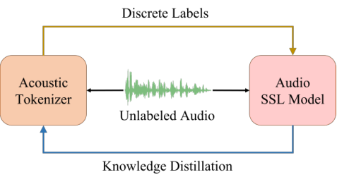
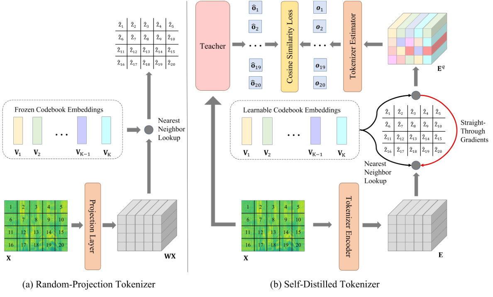
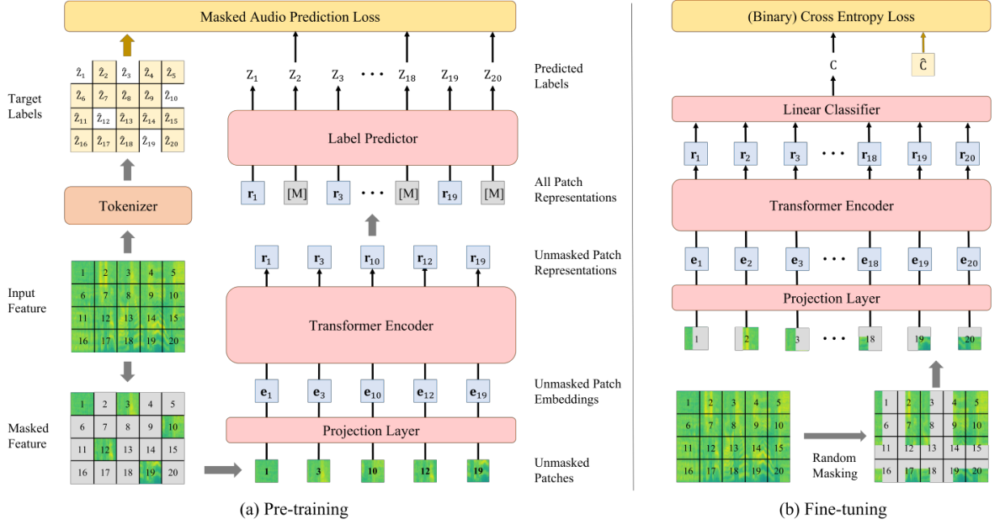
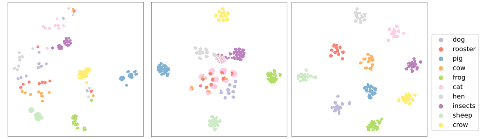

# Paper Reviewer Skills 📄🔍

  <a href="README.md">English</a> • <a href="README_ZH.md">中文</a> • <b>Showcase (样例展示)</b>

  
  
  

---

# 从特征重建到语义离散化：迭代式声学分词器如何重构音频自监督学习的性能极限

### 论文基本信息 (Metadata)
* **文章名字:** BEATs: Audio Pre-Training with Acoustic Tokenizers
* **作者与机构:** Sanyuan Chen, Yu Wu, Chengyi Wang, Shujie Liu, Daniel Tompkins, Zhuo Chen, Furu Wei (Microsoft)
* **期刊与会议:** ICML 2023 (Proceedings of the 40th International Conference on Machine Learning)
* **论文类型:** Method / System
* **一句话定位:** 首个通过迭代联合优化声学分词器与自监督编码器的音频预训练框架，彻底打破重建损失的语义瓶颈，以极低训练代价刷新 AudioSet-2M 性能极限。

---

### 一、 完整摘要 (The Perfect Abstract)
通用音频自监督学习（SSL）近年来发展迅速。然而，与语言、视觉、语音等模态广泛采用的离散标签预测目标不同，当前最先进的音频自监督模型（如 Audio-MAE）在预训练时依然采用声学特征重建损失。与重建损失相比，富含语义的离散标签预测能够促使自监督模型抽象出高级音频语义，并丢弃冗余细节，从而与人类的听觉感知相契合。然而，由于音频信号的连续性以及不像语音那样具备天然的音素序列，获取一个适用于通用音频预训练的、富含语义的声学分词器（Acoustic Tokenizer）并非易事。

为了攻克这一挑战，本研究提出了 **BEATs**——一个用于学习双向音频 Transformer 编码器表示的迭代式音频预训练框架，其中声学分词器和自监督音频模型能够通过迭代循环联合进行优化。在首个迭代周期，使用随机投影作为分词器进行冷启动，以“遮掩-离散标签预测”的方式训练自监督模型。在后续迭代中，通过从上一步预训练或微调过的自监督模型中蒸馏语义知识来训练全新的分词器。该迭代循环循环往复，实现声学分词器与自监督模型性能的互促共进。

实验结果表明，该声学分词器能生成富含音频语义的离散标签，而自监督音频模型在多个下游音频分类基准任务上达到了最先进的性能（SOTA），甚至显著超越了参数量更大、使用训练数据更多的前代方案。具体而言，BEATs 在仅使用音频数据的情况下，在 AudioSet-2M 上取得了 50.6% mAP 的全新 SOTA 集成模型成绩，并在 ESC-50 任务上达到了 98.1% 的分类准确率。

---

### 二、 知识背景全景 (Background & Context)
* **前置概念:**
  * **自监督学习（SSL）：** 指无需人工标注数据，通过在海量无标记数据上设计特定预测任务（如遮掩预测、对比学习），使模型自发地提取并表征高阶特征的技术。
  * **声学分词器（Acoustic Tokenizer）：** 一种将连续的时频声学信号映射并量化为离散序列代号（Discrete Tokens）的工具，为掩码语言建模等任务提供可预测的目标。
  * **掩码音频建模（MAM）：** 类似 NLP 中的 BERT 掩码预测任务，通过随机遮掩输入音频时谱图的某些斑块（Patches），驱动编码器预测这些被遮掩斑块所对应的声学分词器离散标签。
* **赛道全景:** 在自监督音频预训练的赛道上，现存的主要路线可分为**对比学习流派**（如 COLA、CLAP）和**特征重建流派**（如 SSAST、Audio-MAE）。虽然重建流派在近年取得了主导性的性能优势，但其核心痛点在于重建损失驱使模型过度关注混响、噪声等无关紧要的低级物理细节，限制了其对高阶语义特征的抽象。
* **出现契机 (Why Now?):** 离散特征预测已经在自然语言（BERT）、计算机视觉（BEiT）和语音处理（HuBERT）中被证实可以为基础模型赋予极佳的语义抽象与鲁棒特征。但在通用非言语音频中，由于缺乏音素等离散基元结构，设计富含高维语义的声学分词器一直是该赛道的空白。BEATs 的提出，恰恰填补了通用音频领域无法高效进行掩码离散标签学习的缺憾，利用迭代演化机制打破了赛道原有的重建瓶颈。

---

### 三、 痛点与动机 (Problem & Motivation)
* **技术瓶颈:** 通用音频信号包含了极其多样的声学事件（如风声、乐器声、动物吠叫等）。它是一组连续、多源的混合波形。在没有现成文本与音素先验信息的情况下，如何对其进行合理的离散语义划分是一大核心瓶颈。如果只对连续声学特征进行简单的 K-Means 聚类，极易被多变的环境噪声和空间混响所主导，产生与真实声学语义无关的“伪标签”；而直接使用特征重建机制，则会导致大量参数被浪费在捕捉无意义的物理细节上。
* **研究动机:** 本项研究的核心动机是：**如何让声学分词器和自监督编码器形成一种“互促进化”的双赢回路？** 既然没有先天的语义分词器，作者考虑以随机投影作为冷启动，接着用训练好的 SSL 编码器特征对分词器进行蒸馏，从而提升分词器输出标签的语义纯度。随后，纯度更高的离散标记又在下一迭代阶段用于反哺 SSL 的掩码标签预测，最终实现两者的协同收敛。

---

### 四、 核心方法 (Innovation & Methods)
* **创新概述:** BEATs 核心架构围绕**迭代更新回路**设计，其主体数据流向与优化机制如图 1 所示。
  
  
  *图 1：BEATs 的迭代式音频预训练流程架构*
  
  在图中，**左侧橙色卡片（Acoustic Tokenizer）**代表当前声学分词器，它接收无标注音频并生成离散的目标标签。**右侧粉色卡片（Audio SSL Model）**接收被大比例掩码的音频分片，并负责在掩码位置预测分词器产生的目标离散标签。当模型收敛后，系统将 SSL模型转换为教师模型，通过**知识蒸馏方式（下部蓝色箭头）**进一步训练优化分词器，以此往复循环。

* **声学分词器细节:** 在每次预训练迭代周期中，声学分词器用于为无标注音频数据提供预训练离散标签。在首次迭代冷启动阶段，通过没有先验教师的随机投影分词器完成（图 2 a）。自第二期迭代开始，则使用基于自监督教师模型蒸馏机制 of 自蒸馏分词器（图 2 b）。
  
  
  *图 2：声学分词器的两种机制：(a) 随机投影分词器，(b) 自蒸馏分词器*

  1. **随机投影分词器（Random-Projection Tokenizer）：**
     对于首期迭代的音频信号 $X = \{x_t\}_{t=1}^T$，首先通过随机初始化的线性映射层 $W$ 将时谱图分片向量 $x_t$ 投影到 $W x_t$ 维度。然后，从一组随机初始化的冷启动码本（Frozen Codebook）$V = \{v_i\}_{i=1}^K$ 中寻找最近邻向量，其索引被用作首次训练的离散语义标签 $\hat{z}_t$：
     $$\hat{z}_t = \arg\min_i \|v_i - W x_t\|_2^2 \tag{1}$$

  2. **自蒸馏分词器（Self-Distilled Tokenizer）：**
     在迭代周期中，使用一个 12 层的 Transformer 作为 Tokenizer Encoder，将输入分片 $X = \{x_t\}_{t=1}^T$ 编码成隐层特征 $E = \{e_t\}_{t=1}^T$。特征在进行 L2 归一化后计算与 Learnable Codebook $V = \{v_i\}_{i=1}^K$ 的最近邻：
     $$\hat{z}_t = \arg\min_i \|l_2(v_i) - l_2(e_t)\|_2^2 \tag{2}$$
     为了克服“Argmin”不可导的数学约束，本方法使用**直通梯度估计（STE，如图 2 右侧红色环形箭头所示）**直接在反向传播时复制量化后 $E^q$ 的梯度至量化前 $E$。之后，通过一个 3 层的 Transformer Estimator 将量化向量映射，并去预测教师模型（Last-iteration SSL）输出的目标特征 $\hat{o}_t$。其综合优化目标包含基于余弦相似度的蒸馏损失和防止码本失活的均方误差损失：
     $$\max_{X \in D} \sum_{t=1}^T \left[ \cos(o_t, \hat{o}_t) - \|\text{sg}[l_2(e_t)] - l_2(v_{\hat{z}_t})\|_2^2 - \|l_2(e_t) - \text{sg}[l_2(v_{\hat{z}_t})]\|_2^2 \right] \tag{3}$$

* **音频自监督模型（MAM）预训练与微调:** 掩码音频建模任务的具体结构如图 3 所示：
  
  
  *图 3：自监督音频编码器预训练 (a) 与下游任务微调 (b) 结构示意*

  * **预训练阶段（图 3 a）：** 对输入的音频谱图分片序列进行大比例的**随机掩码（75% 比例）**，仅将非掩码的 25% 斑块序列（Unmasked Patches）通过线性映射输入 Transformer 编码器（ViT-Base）中，以节省大量计算资源并极大加快训练速度。随后通过 Label Predictor 与遮罩占位符进行拼接，对被遮罩位置的离散标签进行交叉熵损失优化：
    $$L_{\text{MAM}} = - \sum_{t \in M} \log p(\hat{z}_t | X_U) \tag{4}$$
  * **下游微调阶段（图 3 b）：** 当预训练模型收敛后，移去顶部的 Label Predictor，代之以全局平均池化（MeanPool）及 Task-Specific Linear Classifier。微调阶段模型需要接收完整的未掩码时频谱图序列。

---

### 五、 实验 (Highlights & Key Takeaways)
* **实验配置:**
  * **预训练模型规格:** 12层 Transformer 编码器结构，768维隐层向量，8个多头自注意力头。模型总参数量为 90M，与当前主流的自监督模型（如 86M 的 Audio-MAE）对齐。
  * **预训练数据集与细节:** 在 AudioSet-2M 数据集上迭代预训练了三个周期（BEATs_iter1, BEATs_iter2, BEATs_iter3）。为探究有监督数据对语义分词的增益，引入了以微调后的模型作为分词器教师所进行训练的 BEATs_iter3+ 方案。每次预训练在 8 张至 16 张 GPU 下进行，耗费 400K 步。分词器码本容量设为 1024。
* **实验结果:**

  **表 1：BEATs 与前代 SOTA 单模型在音频与语音分类任务上的性能对比**
  | Model | # Param | Data | AS-2M | AS-20K | ESC-50 | KS1 | KS2 | ER |
  | :--- | :--- | :--- | :---: | :---: | :---: | :---: | :---: | :---: |
  | **无预训练 (From Scratch)** | | | | | | | | |
  | PANN [2020] | 81M | - | 43.1 | 27.8 | 83.3 | - | 61.8 | - |
  | ERANN [2022] | 55M | - | 45.0 | - | 89.2 | - | - | - |
  | **域外有监督预训练** | | | | | | | | |
  | PSLA [2021b] | 14M | IN | 44.4 | 31.9 | - | - | 96.3 | - |
  | AST [2021a] | 86M | IN | 45.9 | 34.7 | 88.7 | 95.5 | 98.1 | 56.0 |
  | HTS-AT [2022a] | 31M | IN | 47.1 | - | - | - | 98.0 | - |
  | AudioCLIP [2022] | 93M | TI+AS | 25.9 | - | 96.7 | - | - | - |
  | **域内有监督预训练** | | | | | | | | |
  | AST [2021a] | 86M | IN+AS | 45.9 | - | 95.6 | - | 97.9 | - |
  | PaSST [2021] | 86M | IN+AS | 47.1 | - | 96.8 | - | - | - |
  | CLAP [2022] | 190M | TA | - | - | 96.7 | - | 96.8 | - |
  | **自监督预训练** | | | | | | | | |
  | SS-AST [2022a] | 89M | AS+LS | - | 31.0 | 88.8 | 96.0 | 98.0 | 59.6 |
  | MaskSpec [2022] | 86M | AS | 47.1 | 32.3 | 89.6 | - | 97.7 | - |
  | MAE-AST [2022] | 86M | AS+LS | - | 30.6 | 90.0 | 95.8 | 97.9 | 59.8 |
  | Audio-MAE [2022] | 86M | AS | 47.3 | 37.1 | 94.1 | 96.9 | 98.3 | - |
  | Audio-MAE Large | 304M | AS | 47.4 | 37.6 | - | - | - | - |
  | **本研究工作 (Ours)** | | | | | | | | |
  | BEATS_iter1 | 90M | AS | 47.9 | 36.0 | 94.0 | **98.0** | **98.3** | **65.9** |
  | BEATS_iter2 | 90M | AS | 48.1 | 38.3 | 95.1 | 97.7 | **98.3** | **66.1** |
  | BEATS_iter3 | 90M | AS | 48.0 | 38.3 | 95.6 | 97.7 | **98.3** | 64.5 |
  | **BEATS_iter3+** | 90M | AS | **48.6** | **38.9** | **98.1** | **98.1** | 98.1 | 65.0 |

  > **数据解读与定量分析：** 在表 1 的单模型性能评估中，首期迭代模型 BEATS_iter1（仅使用随机投影分词器作为冷启动）即在 AudioSet-2M 上取得了 47.9% mAP，超过了之前最强的掩码重建 SOTA 编码器 Audio-MAE（47.3% mAP）以及在 ImageNet 进行了大量有监督预训练的 AST，这强力证实了离散化标签预测相较于传统波形/特征重构机制在提取全局语义特征上的显著效率。在经历三个迭代周期及融入教师微调后，BEATS_iter3+ 以 90M 的参数体量击败了 304M 的 Audio-MAE Large，并在 ESC-50 数据集上将分类错误率从 5.9% 相对压缩 25% 至 1.9%。这说明迭代式自蒸馏分词器能够极其有效排除不相干的时频结构噪声。

  **表 2：不同分词器选择（分词器教师类型）对自监督编码器最终性能的影响**
  | Model | Tokenizer Type | Tokenizer Teacher | SSL Data | SL Data | AS-2M | AS-20K | ESC-50 |
  | :--- | :--- | :--- | :---: | :---: | :---: | :---: | :---: |
  | BEATS_iter1 | Random-Projection | N/A | AS | - | 47.9 | 36.0 | 94.0 |
  | BEATS_iter2 | Self-Distilled | BEATS_iter1 | AS | - | 48.1 | 38.3 | 95.1 |
  | BEATS_iter3 | Self-Distilled | BEATS_iter2 | AS | - | 48.0 | 38.3 | 95.6 |
  | BEATS_iter3+ | Self-Distilled | BEATS_iter2 on AS-20K | AS | AS-20K* | 48.0 | 38.9 | 96.2 |
  | **BEATS_iter3+** | Self-Distilled | BEATS_iter2 on AS-2M | AS | AS | **48.6** | **41.8*** | **97.1**† |

  > **数据解读与局限性评估：** 分析表 2 的结果可见，使用经过自监督训练教师指导的自蒸馏分词器，在各类任务中性能皆明显优于冷启动的随机投影分词器（如 AS-20K 上从 36.0% 提升至 38.3%）。这一结论在低资源少样本的下游任务中表现尤为明显。然而，消融实验亦揭示出，如果单纯在无监督教师上重复自蒸馏（如使用预训练 BEATS_iter2 训练 iter3 分词器），模型的最终指标会出现平台期或微弱衰退（AS-2M 上从 48.1% 回落至 48.0%）。这表明单纯依靠无监督知识自我蒸馏存在“语义泛化盲区”，必须通过在分词器训练中融入有监督下游梯度（如 BEATS_iter3+ 方案引入微调教师），才能进一步拉高模型特征编码的上限。

  **表 3：BEATs 多模型集成与行业主流 SOTA 集成方案在 AudioSet-2M 上的性能对比**
  | Model | SL Data | AS-2M (mAP) |
  | :--- | :---: | :---: |
  | PSLA (Ensemble) [2021b] | IN+AS | 47.4 |
  | AST (Ensemble) [2021a] | IN+AS | 48.5 |
  | HTS-AT (Ensemble) [2022a] | IN+AS | 48.7 |
  | PaSST (Ensemble) [2021] | IN+AS | 49.6 |
  | BEATS (5 models) | AS | 50.4 |
  | **BEATS (10 models)** | AS | **50.6** |

  > **数据解读与工程考量：** 在集成模型层面（表 3），BEATs 相比于在此前占据主导地位的视觉-音频多源集成方案 PaSST（49.6% mAP）实现了大幅跨越，BEATS (10 models) 最终取得了 50.6% mAP 的绝对佳绩。然而，在真实业务系统落地中，10 模型融合预训练与微调需要消耗成倍的算力与显存空间，推理开销增加。因此，在受限低延迟部署场景下，依旧推荐优先采用在表 1 中表现优异的 BEATS_iter3+ 单模型（48.6% mAP），其在速度和存储占用上具备更高的工程实用价值。

* **不同预训练目标鲁棒性可视化分析:** 为了从定量和定性的角度印证“离散语义预测”优于“特征重建”的假说，作者提取了来自 ESC-50 验证集的不同声学事件（狗吠、鸡鸣等共 10 个类别），在波形上叠加上各种环境噪扰（DNS噪声、混响），并对各模型产生的预训练特征输出使用 t-SNE 降维至 2-D 平面进行投射（如图 4 所示）。
  
  
  *图 4：不同模型预训练目标对音频添加噪声混响扰动后的 t-SNE 聚类可视化*
  
  **聚类结果评估:** 在图 4 (a) 重建模型中，相同声学事件在引入不同波形干扰后，其特征向量在降维图上散落极开，而不同类别音频（如 dog 与 sheep）反倒因背景噪声相似而被紧密团聚在了一起。这清晰地论证了重建模型为了将波形还原，保留了过多的时频冗余与背景特征。
  
  相反，在图 4 (b) 自监督蒸馏分词器和 (c) 微调教师引导分词器量化空间中，相同类别的音频斑块能够强力收敛为一个又一个紧密且边界明晰的“语义簇”，这说明自蒸馏声学分词器在预训练时不仅具备噪声 and 混响的不变性，更成功抛弃了声学重建所需的低级繁缛细节，实现了与人脑听觉类似的“语义范畴化（Categorical Perception）”。

  **表 4：BEATs 预训练各个阶段以及各下游微调任务 of 详细超参数配置表**
  | Hyperparameters | Tokenizer Training (SSL Teacher) | Tokenizer Training (SL Teacher) | Model Pre-Training | Model FT (AS-2M) | Model FT (AS-20K) | Model FT (ESC) | Model FT (KS1) | Model FT (KS2) | Model FT (ER) |
  | :--- | :---: | :---: | :---: | :---: | :---: | :---: | :---: | :---: | :---: |
  | **Optimizer** | AdamW | AdamW | AdamW | AdamW | AdamW | AdamW | AdamW | AdamW | AdamW |
  | **Optimizer Momentum** | $\beta_1=0.9, \beta_2=0.98$ | $\beta_1=0.9, \beta_2=0.98$ | $\beta_1=0.9, \beta_2=0.98$ | $\beta_1=0.9, \beta_2=0.98$ | $\beta_1=0.9, \beta_2=0.98$ | $\beta_1=0.9, \beta_2=0.98$ | $\beta_1=0.9, \beta_2=0.98$ | $\beta_1=0.9, \beta_2=0.98$ | $\beta_1=0.9, \beta_2=0.98$ |
  | **Weight decay** | 0.01 | 0.01 | 0.01 | 0.01 | 0.01 | 0.01 | 0.01 | 0.01 | 0.01 |
  | **LR Schedule** | Linear Decay | Linear Decay | Cosine | Cosine | Cosine | Cosine | Cosine | Cosine | Cosine |
  | **Steps** | 400K | 400K | 50K | 80K | 80K | 80K | 80K | 80K | 80K |
  | **Warmup epochs** | 32K | 32K | 5K | 8K | 8K | 8K | 8K | 8K | 8K |
  | **GPU** | 8 | 8 | 16 | 16 | 4 | 4 | 4 | 4 | 4 |
  | **Batch size (s)** | 1.4K | 1.4K | 5.6K | 6.4K | 800 | 300 | 100 | 100 | 300 |
  | **Layer-wise LR decay**| 1.0 | 1.0 | 1.0 | 0.6 | 0.3 | 0.2 | 0.3 | 0.3 | 1.0 |
  | **Peak learning rate** | 5e-5 | 5e-4 | 5e-4 | 5e-4 | 1e-4 | 3e-5 | 1e-4 | 1e-4 | 3e-5 |
  | **Weighted Sampling** | - | - | - | - | - | - | * | - | - |
  | **Dropout** | 0.1 | 0.1 | 0.0 | 0.0 | 0.0 | 0.0 | 0.0 | 0.0 | 0.0 |
  | **Layer Dropout** | 0.0 | 0.0 | 0.1 | 0.1 | 0.1 | 0.1 | 0.1 | 0.1 | 0.1 |
  | **SpecAug** | N/A | N/A | - | 0.3 | 0.2 | 0.3 | 0.15 | 0.15 | 0.15 |
  | **Mixup** | N/A | N/A | 0.0 | 0.8 | 0.0 | 0.8 | 0.0 | 0.0 | - |
  | **Loss Function** | CosineSimilarity | CosineSimilarity | CE | BCE | BCE | CE | BCE | BCE | CE |
  | **Dataset Mean** | 15.41663 | 15.41663 | 15.41663 | 15.41663 | 15.41663 | 11.72215 | 11.43905 | 11.41045 | 12.08890 |
  | **Dataset Std** | 6.55582 | 6.55582 | 6.55582 | 6.55582 | 6.55582 | 10.60431 | 5.64913 | 5.67857 | 4.29147 |

  > **注\*：** 在针对 Speech Commands V1 (KS1) 数据集进行微调时，每个训练 epoch 中会将各个类别平衡抽样至未知（unknown）类别容量的 50%，以消除长尾分布影响。

---

### 六、 极客评分 (Geek Evaluation)
* **💡 创新性 (9.0/10)：** **理由：** 彻底颠覆了音频 SSL 领域长久以来的掩码重建架构。将 NLP 与语音中的掩码离散标记预测（MAM）带入通用音频预训练，并精妙设计了能够轮流精炼、互促演进的迭代式自蒸馏声学分词器，理论架构具有强烈的开拓性。
* **🛠️ 实用性 (8.5/10)：** **理由：** 预训练通过 75% 的超高掩码率实现了极高加速，且在推理微调时，ViT-Base 的 90M 参数体量对于服务器端和高配边缘端都极易部署。然而，在训练上，其需要声学分词器与自监督音频模型反复交替迭代（多次 400K 步的流程），前期开发调优的训练管线相对传统单阶段模型较为复杂。
* **🛠️ 行业价值 (9.0/10)：** **理由：** 开创了统一语言、视觉、语音和通用非言语音频预训练格式的先河，为打造全模态大一统离散底座提供了基石级别的技术方案。同时，该自蒸馏声学分词器在业界已经成为构建新一代多模态大模型（如跨模态音频理解大模型）进行底层声学信号离散化表征的核心参考组件之一。
